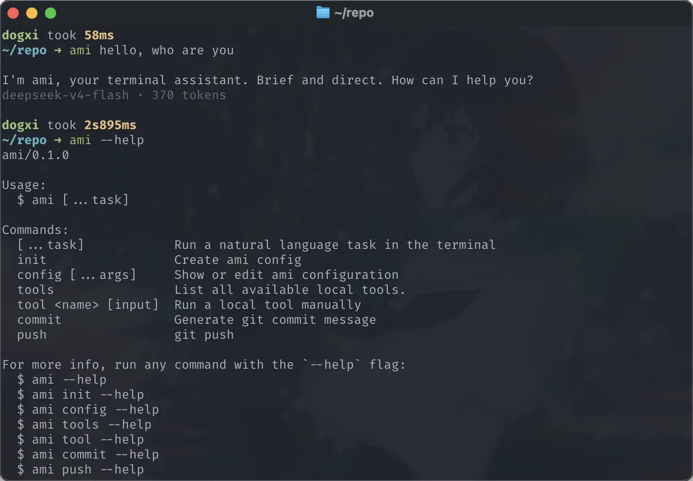

# Ami

轻量级终端 AI Agent，通过 `ami <task>` 理解项目、修改文件、运行命令并验证结果。支持多模型、管道输入和会话恢复，也保留顺手的 Git commit / push 工作流。

[官网](https://ami.dogxi.me) · [npm](https://www.npmjs.com/package/@dogxi/ami) · [反馈建议](https://github.com/dogxii/ami/issues)




## ✨ 为什么用

- 在终端里直接问项目问题，不需要切到网页聊天窗口。
- 内置文件读写、代码搜索和命令执行，能沿着“定位 → 修改 → 验证”持续完成任务。
- 大文件按需读取，命令输出、搜索结果和管道输入完整保存在本地，可分页续读。
- 支持 OpenAI-compatible API，可接入 OpenAI、DeepSeek、Qwen 或自定义服务。
- 单次任务没有固定的工具调用次数限制，可按需设置时间、步骤和 token 预算。
- 本地 JSONL 会话记录、上下文自动压缩和 `--continue`，让长任务能继续。
- 单个 Go 原生可执行文件，无需 Node.js、后台服务或数据库。
- 提供 `ami commit` / `ami push`，让提交信息和推送流程更顺手。

## 🚀 快速开始

macOS/Linux 可使用校验 SHA-256 的原生安装脚本，Windows 可从 [GitHub Releases](https://github.com/dogxii/ami/releases/latest) 下载对应 `.exe`：

```bash
curl -fsSL https://raw.githubusercontent.com/dogxii/ami/main/scripts/install.sh | sh
# 或使用可选 npm 启动器（Node 20.12+，零 npm 依赖）
npm install -g @dogxi/ami
```

npm 只负责下载并启动原生程序；直接使用二进制能获得更快启动。安装目标默认 `~/.local/bin`，可用 `AMI_INSTALL_DIR` 指定。配置了 HTTP(S)/ALL_PROXY 时，npm 安装器使用系统 `curl` 下载，并遵循 `NO_PROXY`；否则使用 Node 内置下载。

也可从源码构建（Go 1.24+）：

```bash
make build
./dist/ami init
./dist/ami "解释这个项目"
```

将 `dist/ami` 放入 PATH 后即可使用 `ami`。Windows 构建：

```powershell
go build -trimpath -ldflags "-s -w" -o dist/ami.exe ./cmd/ami
```

然后在任意项目目录里使用：

```bash
ami "explain internal/ami/cli.go"
ami "summarize the git status"
ami "search where loadConfig is used"
ami "review the current changes"
ami "修复构建错误，并重新运行构建验证"
ami --yes "为这个函数添加测试并验证"
ami --read-only "分析项目架构"
ami --continue "继续处理剩余问题"
```

默认在需要修改文件或执行命令时询问，授权按能力在本次运行内复用。`--yes` 适用于可信本地项目；也可用 `ami trust` 记住对当前目录的授权。命令使用你的系统账户权限，当前版本没有 OS 沙箱。

也可以把其他命令的输出交给 Ami：

```bash
git diff | ami "review these changes"
npm test 2>&1 | ami "explain this error"
cat README.md | ami "summarize"
```

## ⚙️ 配置

`ami init` 会交互式创建全局配置文件：

```text
~/.config/ami/config.json
```

也可以手动查看和修改：

```bash
ami config
ami config get model
ami config set model gpt-5.4-mini
ami config set apiKey sk-...
ami config set tavilyApiKey tvly-...
```

环境变量优先级高于配置文件：

```bash
AMI_BASE_URL=https://api.deepseek.com/
AMI_API_KEY=...
AMI_MODEL=deepseek-v4-flash
AMI_TAVILY_API_KEY=...
```

`AMI_TAVILY_API_KEY` 仅在使用 `web_search` 工具时需要。

## 🧭 命令

```bash
ami <task>              # 执行自然语言任务
ami --yes <task>        # 本次运行自动允许文件编辑和命令执行
ami --read-only <task>  # 只读分析，禁止文件写入和 shell 命令
ami --ask <task>        # 即使目录已被信任，也重新询问授权
ami --cwd <path> <task> # 指定工作目录
ami --continue [task]  # 继续当前目录最近的任务
ami --session <id> [task] # 恢复指定会话
ami --no-session <task> # 不保存历史；输出保存在临时目录
ami --json <task>      # stdout 输出 JSONL 事件
ami sessions           # 列出当前目录的会话
ami output <id> --session <session-id> --offset <bytes> # 查看完整工具输出
ami trust              # 记住当前目录的执行授权
ami trust --revoke     # 撤销当前目录的信任
ami trust --list       # 查看已信任目录
ami init                # 初始化全局配置
ami config              # 查看当前配置
ami config get <key>    # 读取配置项
ami config set <key> <value>  # 更新配置项
ami tools               # 列出可用工具
ami tool <name> [json]  # 手动运行工具
ami commit              # 根据 staged diff 生成提交信息并确认提交
ami commit --yes        # 明确允许非交互提交
ami commit --all        # 先 git add -A，再生成提交信息
ami push                # 检查分支状态并推送
ami push --commit       # 暂存、生成 commit 并推送
ami push --rebase       # 获取远端更新，确认后 rebase 并推送
ami push --yes          # 跳过 commit 和 push 确认，不跳过 rebase 确认
ami push --rebase --yes # 明确允许无确认 rebase 和 push
ami push --commit --rebase --yes # 暂存、提交、rebase 并推送
ami update              # 检查并更新到最新版本
ami update --yes        # 无需确认直接更新
```

Ami 每 24 小时最多检查一次新版本，并只在交互式终端的问答结束后提示。设置 `AMI_NO_UPDATE_CHECK=1` 可以关闭该提示。

### 任务预算与上下文

```bash
ami --yes --max-steps 50 --timeout 600 "修复测试"
ami --context-window 64000 --output-bytes 24000 "分析大型项目"
ami --max-tokens 100000 "检查改动"
```

`--max-steps`、`--max-tokens` 和 `--timeout` 默认均为 0，表示不设任务总预算。步骤预算统计工具调用；达到预算后仍给模型一次收尾机会。token 预算在模型请求之间检查，包含压缩请求；提供商未返回用量时使用估算。连续三次相同工具错误会停止并保存现场。

`--context-window` 默认 32,000 tokens，应按所用模型调整。接近容量时会总结早期历史，保留近期工具调用及对应结果；持久会话的原始记录仍保存在本地。`--output-bytes` 默认 16,000，是单个内容页的字节预算，不含元数据和 JSON 编码开销；会随上下文容量约束，不是文件总大小上限。命令的 stdout 和 stderr 分别分页，轮询返回新增页面，完整日志仍可通过 `read_output` 重读。模型请求默认超时 180 秒，可通过 `--request-timeout` 调整。

## 🧰 工具能力

| 工具              | 说明                                             |
| ----------------- | ------------------------------------------------ |
| `read_file`       | 流式读取任意大小的文本文件，支持行范围和字节偏移 |
| `list_files`      | 按指定深度列目录，完整列表可续读                 |
| `search_code`     | 优先使用 ripgrep，完整搜索结果可续读             |
| `git_status`      | 查看 Git working tree 状态                       |
| `git_diff`        | 查看工作区、暂存区或全部已跟踪改动               |
| `web_search`      | 使用 Tavily 搜索最新或外部信息                   |
| `edit_file`       | 精确替换文本，检查唯一匹配和文件版本             |
| `write_file`      | 创建文件，覆盖需要已读取的当前版本               |
| `exec_command`    | 运行命令，返回退出码、日志和进程 ID              |
| `process_control` | 查询进度、写入 stdin、停止当前运行的命令         |
| `read_output`     | 按字节偏移读取已保存的完整输出                   |

工具结果包含 `nextOffset` 时，可用 `read_file` 或 `read_output` 继续读取。文件范围没有固定的 500 行上限；目录深度、文件总大小和搜索总结果也没有旧版硬限制。单次返回仍受上下文页面预算约束。

命令默认最多运行 120 秒，模型可设置 `timeoutMs`，0 表示取消命令超时；`waitMs` 决定初次等待时长，长命令返回进程 ID。进程仅属于当前 CLI 调用，退出和取消时清理被跟踪的命令组；恢复会话不会重新挂接旧进程。独立脱离命令组的守护进程不属于这个生命周期，Windows 也无法清理父进程已退出的孤儿进程树。二进制输出页会标注 `encoding=base64`，原始字节仍完整保存在输出文件中。

OpenAI-compatible 提供商须支持原生 function calling 才能执行文件修改和命令。仅支持 JSON 文本的提供商会自动降级为只读模式。

### 会话与项目指令

启动时读取工作目录下的 `AGENTS.md`、`AMI.md` 和 `.ami/instructions.md`。这些文件可以说明代码规范和验证命令，不能扩大权限；修改子目录之前模型还会被要求查看该目录的指令。

默认会话位于 `~/.local/state/ami/sessions/`，遵循 `XDG_STATE_HOME`，也可用 `AMI_STATE_DIR` 覆盖。每个会话包含私有的 `events.jsonl` 和 `outputs/`，记录可能含有源码、命令输出和用户输入。`--no-session` 不保存会话历史，临时输出目录仍保留供排错；目录路径会显示在终端，并包含在 JSON 运行事件中。

普通模式将回答写到 stdout，工具进度和统计写到 stderr；`--json` 的 stdout 只包含 JSONL 事件，适合脚本消费。在管道、CI 或 JSON 模式下无法交互授权，执行任务应明确使用 `--yes`，或提前信任工作目录。

## 🔒 安全边界

- 文件工具只访问工作目录内的文件，检查符号链接的真实目标。
- `.git`、`node_modules` 和 `.env` 等秘密文件会被文件工具拦截；`.env.example`、`.env.sample` 和 `.env.template` 可作为模板读取。
- `list_files` 会显示敏感目录的存在，但不会进入其中。
- `edit_file` 需要先读取文件；文件被其他程序改变后，编辑与覆盖会拒绝，要求重新读取。
- `--read-only` 在工具执行入口禁止写入和 shell 命令，模型请求未开放的工具也无法绕过。
- shell 使用系统权限，可以访问工作目录以外的位置；文件工具的路径拦截不约束 shell。`--yes` 和 `ami trust` 只应授予可信本地任务。
- 子进程不默认继承 ami 配置和名称包含 KEY、TOKEN、SECRET、PASSWORD、CREDENTIAL 的环境变量。需要项目凭据时应单独配置所运行的程序。
- 网络搜索仍可在只读模式下使用；只读模式不代表离线或 OS 隔离。
- `ami commit` 会展示生成的 commit message，并在确认后才提交。
- `ami push` 不会自动提交工作区改动，只有 `--commit` 会暂存并提交全部改动。
- `ami push` 遇到 non-fast-forward 会获取远端状态，并询问是否 rebase 后重试。
- 只有 `--rebase --yes` 会跳过 rebase 确认；单独使用 `--yes` 不会授权 rebase。
- rebase 出现冲突时会立即停止并保留现场，不会自动改文件、continue 或 force push。

## 🛠️ 本地开发

```bash
git clone https://github.com/dogxii/ami.git
cd ami
go run ./cmd/ami "解释项目"
make build
./dist/ami tools
make check
```

`make check` 运行竞态检查、完整回归测试和 `go vet`。可选 npm 启动器与安装脚本测试：

```bash
node --test test/npm.test.mjs
# npm run build / npm test 也可用
```

实现位于 `cmd/ami` 和 `internal/ami`，使用标准库和 `golang.org/x/term`，无 Agent 框架。Release 工作流生成六个平台产物与校验清单，CI 在 macOS/Linux/Windows 运行测试。推送版本标签前同步 `VERSION` 与 `package.json`；npm 发布使用 `npm publish`，无需把本机构建产物打入包内。

原生发行支持 macOS、Linux 和 Windows 的 amd64/arm64，二进制含版本号，安装与 `ami update` 校验 Release 的 SHA-256。配置、授权与 v1 JSONL 会话可沿用 TypeScript 版本；恢复时重新读取文件版本，未记录结果的操作不会自动重放。

官网页面在 `site/` 目录，可直接作为静态站部署。

运行架构与恢复语义见 [docs/architecture.md](docs/architecture.md)。测试使用本地模拟模型服务，覆盖执行、编辑重试、大文件、大输出、恢复、上下文压缩、JSON 协议与取消，不调用付费模型 API。

## 📈 项目 Star 历史

<a href="https://www.star-history.com/?repos=dogxii%2Fami&type=date&legend=bottom-right">
 <picture>
   <source media="(prefers-color-scheme: dark)" srcset="https://api.star-history.com/chart?repos=dogxii/ami&type=date&theme=dark&legend=bottom-right" />
   <source media="(prefers-color-scheme: light)" srcset="https://api.star-history.com/chart?repos=dogxii/ami&type=date&legend=bottom-right" />
   
 </picture>
</a>

## 📄 License

MIT [@Dogxi](https://github.com/dogxii)
