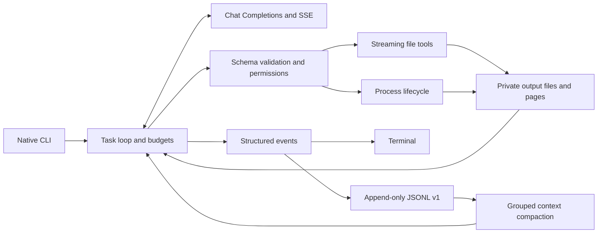

# Ami architecture

Ami is a native Go CLI. The application uses the standard library, `golang.org/x/term` and `golang.org/x/sys`. There is no daemon, database, agent framework, embedded JavaScript engine, or separate execution service. `cmd/ami/main.go` supplies the build-time version; cohesive implementation files live in `internal/ami` rather than an interface layer per feature.

## Entry and user workflows

`cli.go` parses interspersed options and routes task, tool, config, session, trust, Git and update commands. Help/version do not initialize sessions, check versions, read configuration or access the network. `config.go` preserves the TypeScript configuration path and environment precedence, private atomic config writes and exact canonical workspace trust. Terminal credential input is hidden and terminal state is restored on cancellation. Invalid/unreadable config files fail explicitly; AMI_CONFIG_FILE selects an optional custom path. doctor checks local configuration, credential sources, command availability and writable directories without network requests; --check opts into a small model request with a tool schema and never executes returned calls.

`git.go` preserves staged/all commits, commit/push confirmation, upstream checks, fetch/rebase, non-fast-forward retry and conflict preservation. Only `--rebase --yes` bypasses rebase approval; `--yes` alone does not. Explicit Git workflows can use host Git credentials; model-invoked command environments filter credential names.

## Provider and task loop

`provider.go` normalizes root, `/v1`, custom prefix and explicit Chat Completions endpoints. It uses reusable HTTP connections, context deadlines, cancellation and limited network/transient-status retries with Retry-After handling, jitter, cancellation and retry events. SSE parsing assembles complete tool-call messages before any action; truncated streams, length/content-filter stops, malformed arguments and duplicate call IDs cannot execute a partial batch. Stream usage incompatibility is remembered per provider. JSON compatibility is read-only and retains tool results in subsequent requests.

`agent.go` records the complete assistant call message before executing its calls and records each result afterward. Tools remain sequential to preserve mutation dependencies. There is no default call limit; optional tool/token/time budgets, conservative usage estimates and three identical errors stop uncontrolled loops. Later calls in a failed/budget-exhausted batch receive explicit non-execution results. Step exhaustion permits a final request without tools. Cleanup finishes before the terminal event.

Instructions come from AGENTS.md, AMI.md and .ami/instructions.md, ordered from the Git project root to cwd. Before file mutations, new/changed instructions from intermediate and target directories are returned to the model before retrying the edit. Large instructions have a full-output reference; file-tool boundaries remain cwd scoped. Piped input streams to an artifact and enters context as a bounded preview with a full-output reference. These inputs cannot expand tool permissions.

Context compaction retains the original task and recent assistant/tool groups. Earlier history is summarized in bounded batches. Token budgets are checked between summary requests; the history snapshot changes only after a successful, sufficiently small summary. The original JSONL transcript remains available.

## File and tool boundary

`tools.go` owns the 11 schemas, strict input validation, per-run allowlist and permission dispatch. Bounded command/working-directory and file replacement previews precede approval; successful file-tool changes are included in terminal outcomes. `runtime.go` owns run-scoped authorization and redacted events. `--yes` or saved trust enables writes/commands; `--ask` overrides saved trust; `--read-only` blocks side effects at both advertisement and dispatch. A manual `ami tool` explicitly authorizes that operation, while `--read-only` still overrides it.

`files.go` canonicalizes paths and checks workspace containment and blocked components, including existing ancestors of missing paths and symlink targets. Directory traversal never follows links. `.git`, `node_modules` and secret `.env` files are blocked. UTF-8 byte pages and late line ranges use bounded buffers, including huge single lines; binary artifacts return base64. Opaque file versions include filesystem identity, size and modification metadata. Re-read files after continuation; TypeScript version strings are intentionally not reused across invocations.

`edit.go` replaces exact matches across stream chunks, rejects ambiguous/stale edits, preserves permissions and commits through same-directory temporary files. Creation uses an exclusive hard-link commit so it cannot overwrite a concurrent creation. The temporary link is removed before computing the final version. These checks protect ordinary concurrent changes; they are not containment against hostile concurrent filesystem mutation.

`search.go` retains complete listings/search matches on disk with bounded previews. It uses ripgrep when available and a Go fallback otherwise. The fallback has no whole-file-size cap; search may retain a single source line and the requested context lines, while ordinary file paging remains bounded.

## Processes and output

`processes.go` uses `os/exec`, streaming writers and private stdout/stderr files. Spawn failures settle immediately, avoiding pipe-end compatibility issues. Each process exposes start/output/completion events, exit/signal metadata, deadlines, polling, stdin and stop. Polling advances independent stdout/stderr cursors; `read_output` can revisit the entire log. Structured results keep metadata at the top level and do not create nested output artifacts.

Unix shell commands use their own process group; shutdown/cancellation sends TERM then KILL, including background descendants after a shell exits. Windows uses non-interactive PowerShell and `taskkill /T /F` while the parent is alive; a bounded pipe wait prevents an exited Windows parent from hanging shutdown. Windows cannot safely recover an orphan child tree. Detached daemons are outside this lifecycle. No PTY or process reattachment across CLI invocations is provided.

Commands use host account permissions. Trust/approval are policy, not an OS sandbox. Both process output and complete files remain local; response pages bound context rather than total output retention.

## Persistence and events

`session.go` preserves JSONL v1 headers/message/context records and existing session IDs, output names, XDG/AMI_STATE_DIR storage and workspace-scoped latest-task pointers. A file descriptor stays open for appends; concurrent writes are serialized. A stable session lock file under sessions/.locks uses Unix flock or Windows LockFileEx, preventing concurrent restore/delete across processes and releasing automatically on exit. The lock files remain outside deletable session directories, avoiding inode-replacement races. Read-only list/show/export do not repair logs; scoped deletion and age-based pruning recheck activity under the lock and skip active sessions. A deleted latest-task pointer falls back to the most recently used remaining task. Deltas and process-byte notifications are not duplicated in history. Recording failure prevents subsequent actions; cleanup still runs if the event sink fails.

Restoration repairs only a torn final record, rejects earlier corruption and inserts uncertain tool results without replaying actions. Workspace mismatches are rejected. Output inspection validates only the bounded header and reads its artifact; it does not restore or repair history. Manual tools/help do not activate the latest-task pointer. `--no-session` retains temporary artifacts but no transcript.

Normal stdout carries assistant text, stderr progress; JSON mode carries JSONL events and exactly one terminal event. Known secrets are redacted in emitted events. Logs/artifacts have private permissions, but arbitrary user content/command output can contain secrets.

## Build, install and update

`make build` creates a stripped, CGO-free binary. Source builds require Go 1.24+; CI and releases use Go 1.26.x. CI tests on macOS/Linux/Windows; the tag release workflow reuses those tests before building six amd64/arm64 executables and `checksums.txt`. `scripts/install.sh` and `update.go` verify SHA-256 before replacing an executable. Optional update notices use a 24-hour success cache, a one-hour failure backoff and a 10-second background request deadline without delaying completion. update --check only inspects versions; update --to selects an existing release, including older versions for explicit rollback.

The npm package has zero npm dependencies and only installs/launches the matching native release. Downloads use Node's built-in fetch or system curl when proxy environment variables are configured; curl honors HTTP(S)/ALL_PROXY and NO_PROXY on Node versions without native environment-proxy support. Both paths verify a streamed file checksum before replacement. Post-release checks install the actual npm tarball and direct executable, validate versions and run real commands on Windows/Linux/macOS and Node 20/22/24 before npm publication. Its file allowlist excludes downloaded executables so a local installation cannot accidentally package one platform's binary. Local npm development commands invoke Go; direct binary use avoids launcher overhead. `VERSION` is embedded in every Go build; release validation checks that the tag and npm version agree with it.

## Validation

`go test -race -timeout 3m ./...`, `go vet ./...`, `node --test test/npm.test.mjs`, and native cross-builds. Fixtures exercise multi-step tasks, strict permissions, incomplete/invalid streams, usage fallback, budgets/compaction, TypeScript session restoration, large Unicode/binary files, stale/ambiguous edits, complete outputs beyond 10 MiB, incremental polling, spawn failure, stdin, deadlines, SIGINT/group cleanup, local bare Git remotes, rebase approval/conflicts and checksum rejection. Model tests use local HTTP services and no paid API.
